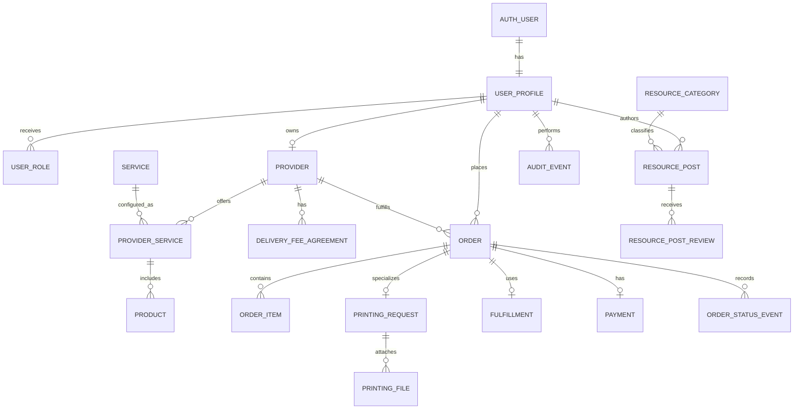

# PASOA Student Services

## System Architecture and Data Model

**Version:** 1.0  
**Related product document:** [PRD.md](./PRD.md)  
**Institution:** Polytechnic University of the Philippines - Taguig  
**Status:** Recommended MVP architecture

---

## 1. Architectural Summary

PASOA should be implemented as a **shared-backend, multi-client platform**:

```text
React web client          Flutter client (later/native)
          \                    /
           \                  /
          Netlify platform
     React hosting + Functions
          + external services
                    |
          External services (optional)
```

The React application is the primary web client for the MVP. The existing Flutter application should consume the same backend through HTTPS API endpoints exposed by Netlify Functions and shared domain contracts; it must not create a separate data source or business-rule implementation.

The recommended backend is a **Netlify-hosted modular serverless application backed by managed PostgreSQL**. Netlify provides the web deployment, previews, CDN, serverless Functions, scheduled Functions, and environment management. Neon PostgreSQL provides relational persistence, transactions, constraints, and reporting. Netlify Blobs can store private application files behind authenticated Function endpoints; an S3-compatible private bucket may be substituted if file volume or retention requirements outgrow Blobs.

Business-critical actions must execute on the server side or inside PostgreSQL transactions. The clients are presentation layers and must never be trusted to enforce prices, delivery fees, permissions, approval rules, or order transitions.

---

## 2. Architecture Principles

1. **One source of truth:** React and Flutter use the same database, authorization rules, and domain contracts.
2. **Server-authoritative business rules:** Totals, fees, inventory, status transitions, approvals, and permissions are validated outside the client.
3. **Private by default:** Uploaded files, student information, payment proof, drafts, and rejected posts are private unless explicitly published.
4. **Append-only history for important events:** Order status, moderation decisions, fee changes, and administrative actions must be auditable.
5. **Bounded domain modules:** Keep authentication, catalog, orders, rentals, payments, and administration separable even when deployed together.
6. **MVP simplicity:** Start with a modular monolith and managed infrastructure; avoid microservices until scale or team boundaries require them.
7. **Progressive enhancement:** Guests can browse public content; authenticated users unlock transactions and user-specific workflows.
8. **Accessibility and responsive behavior are architectural requirements:** The web client must support mobile-first student use and desktop operational workflows.

---

## 3. Recommended Technology Stack

### 3.1 Client applications

| Area | Technology | Reason |
|---|---|---|
| Primary web client | React 19 + TypeScript | Already present; strong fit for the website and role-based dashboards |
| Web build | Vite 8 | Already present; fast development and production builds |
| Web styling | Tailwind CSS v4 | Already present; supports the PASOA Bento Campus design system |
| Web routing | React Router | Replace the current in-memory screen switcher with URL-addressable routes |
| Web data fetching | TanStack Query | Server-state caching, loading/error states, and mutation handling |
| Web forms | React Hook Form + Zod | Typed validation for printing, checkout, and resource-post flows |
| Mobile/cross-platform client | Flutter 3 / Dart | Existing Flutter client; reuse backend contracts and domain rules |
| Client icons | Lucide React / Flutter Material icons | Consistent, accessible iconography |

### 3.2 Backend platform

| Area | Technology | Reason |
|---|---|---|
| Database | Neon PostgreSQL | Relational data, transactions, constraints, reporting, and portability |
| Authentication | Netlify Identity or institution-approved OIDC via Netlify Functions | Email/password initially; extensible to PUP identity verification |
| Object storage | Netlify Blobs behind authenticated Functions | Private document and payment-proof storage without public bucket access |
| Server-side operations | Netlify Functions in TypeScript | Privileged workflows, file validation, notifications, and payment adapters |
| Authorization | Function middleware plus PostgreSQL authorization checks | Defense in depth for user, provider, and administrator data |
| Realtime | Polling initially; Netlify Functions/webhooks for events | Avoids coupling MVP data to a hosted realtime vendor |
| API contract | OpenAPI document, generated TypeScript types, and versioned DTOs | Prevent drift between web, Flutter, and database schema |

### 3.3 Operations and quality

| Area | Recommendation |
|---|---|
| Source control | Git repository with protected main branch |
| Web hosting | Netlify with separate development previews and production site |
| Database hosting | Neon projects/branches with separate development and production databases |
| CI | GitHub Actions for type-check, lint, tests, build, and database migration checks |
| Error monitoring | Sentry or an institution-approved equivalent |
| Product analytics | Privacy-conscious, opt-in or aggregate analytics only |
| API documentation | OpenAPI document for Netlify Functions and generated database types |
| Secrets | Deployment-provider secret store; never commit `.env` files |

The current `package.json` contains only presentation dependencies. Backend packages and generated clients should be added only when implementation begins, rather than adding unused dependencies to the prototype.

---

## 4. Deployment Topology

```text
Browser
  |
  v
Static React host
  |
  +--> Netlify Identity or institutional OIDC
  +--> Netlify Functions API
  +--> Neon PostgreSQL
  +--> Netlify Blobs (private access through Functions)
            |
            +--> payment-provider adapter (when selected)
            +--> email/notification adapter
            +--> audit and privileged workflows

Flutter mobile/web client
  |
  +--> Same authentication, API, database, storage, and event endpoints
```

### Environments

- **Local:** Netlify Dev with a local PostgreSQL-compatible database or Neon development branch; mock external payment and notification adapters.
- **Development/staging:** Netlify deploy preview or branch deploy with a separate Neon branch, test accounts, and non-production files.
- **Production:** Restricted Netlify site and Neon production database with backups, monitoring, and approved administrators.

Database schema changes must be committed as migrations and promoted through environments. Manual production edits are not allowed.

---

## 5. Backend Module Boundaries

The backend should be a modular monolith with these domains:

### Identity and access

- User profiles and role memberships
- Account status
- Student verification state
- Provider/admin access checks

### Public content

- Landing-page sections
- Service descriptions
- How-it-works content
- Terms and support content
- Announcements and official posts

### Provider collaboration

- Provider records
- Collaboration approval
- Service availability
- Delivery-fee agreements
- Provider operational settings

### Catalog

- Service types
- Provider service offerings
- School-supply products
- Prices and availability
- Resource categories

### Orders and fulfillment

- Printing requests
- School-supply orders
- Order items
- Fulfillment method and location
- Order status transitions
- Order status history

### Payments

- Payment method
- Payment intent/record
- Payment proof
- Verification state
- Receipt data

### Resource hub

- Looking-for posts
- Available-for-rent posts
- Moderation queue
- Approval/rejection reason
- Publication visibility

### Administration and audit

- Role and permission checks
- Moderation actions
- Fee and provider changes
- Audit events
- Operational dashboards

These boundaries are logical modules, not separate deployables. They can be represented as folders, database schemas, Edge Function modules, or service classes as implementation evolves.

---

## 6. Client Architecture

### 6.1 React web application

The current [src/App.tsx](./src/App.tsx) is a prototype screen navigator. Production web architecture should evolve to:

```text
src/
  app/
    router/
    providers/
    auth/
  components/
    ui/
    layout/
  features/
    public/
    student/
    provider/
    admin/
    resources/
    orders/
  lib/
    netlify/
    api/
    validation/
    formatting/
  types/
  styles/
```

Each feature should own its pages, data hooks, forms, and view-model mapping. Shared UI components should contain visual behavior only; they should not fetch or mutate domain data directly.

Recommended request flow:

```text
Page -> feature hook -> Netlify Function -> Neon PostgreSQL/Netlify Blobs
  ^          |
  |          +--> typed loading/error/success state
  +----------+--> cache invalidation or realtime update
```

Use Netlify Functions for all application reads and writes. Functions may call parameterized SQL for simple reads and database transactions for multi-step writes and privileged operations. Do not expose database credentials or connect clients directly to Neon.

### 6.2 Flutter application

The existing [student-service-hub/lib](./student-service-hub/lib) application should use a layered structure:

```text
lib/
  app/
  core/
    auth/
    networking/
    storage/
    errors/
  features/
    public/
    student/
    provider/
    admin/
    resources/
    orders/
  shared/
    widgets/
    models/
```

Flutter should not duplicate server-side pricing, permission, approval, or state-machine logic. It may validate input for usability, but the backend remains authoritative.

### 6.3 Shared client contracts

The clients must share:

- Enumerated role, status, category, and payment values.
- API request and response shapes.
- Money representation rules.
- Date/time serialization rules.
- Error codes and user-safe messages.
- File-upload constraints.

Use generated types from the database schema for TypeScript. For Dart, generate or maintain DTOs from the same versioned HTTP API contract rather than hand-translating database tables in every screen.

---

## 7. Data Model

### 7.1 Modeling conventions

- Use UUID primary keys.
- Store timestamps as `timestamptz` in UTC.
- Store Philippine display time through the client or a configured timezone.
- Store money as integer minor units (`amount_centavos`) plus `currency_code`, not floating-point values.
- Use explicit status columns and append-only history tables.
- Use soft deactivation (`active`, `status`, or `deleted_at`) for records referenced by historical transactions.
- Use foreign keys and database check constraints for invariant data.
- Do not store raw payment-card data.

### 7.2 Entity relationship overview



### 7.3 Identity tables

#### `user_profiles`

Extends the authentication provider’s user record.

| Column | Type | Notes |
|---|---|---|
| `id` | UUID PK | Same identifier as auth user |
| `display_name` | text | User-visible name |
| `email` | text | Managed consistently with auth |
| `phone` | text nullable | Required only for configured fulfillment flows |
| `account_status` | enum | `pending`, `active`, `suspended`, `rejected` |
| `student_verification_status` | enum nullable | `not_required`, `pending`, `verified`, `rejected` |
| `created_at`, `updated_at` | timestamptz | Audit timestamps |

#### `user_roles`

| Column | Type | Notes |
|---|---|---|
| `user_id` | UUID FK | References `user_profiles` |
| `role` | enum | `student`, `provider`, `admin`, `co_admin` |
| `granted_by` | UUID nullable | Internal actor for elevated roles |
| `created_at` | timestamptz | Assignment time |

Use a unique constraint on `(user_id, role)`. Guest access is represented by an unauthenticated session, not a persisted elevated role.

### 7.4 Provider and catalog tables

#### `providers`

| Column | Type | Notes |
|---|---|---|
| `id` | UUID PK | Provider identifier |
| `owner_user_id` | UUID FK | Provider account owner |
| `business_name` | text | Public provider name |
| `description` | text | Public profile |
| `contact_details` | jsonb | Restricted according to role |
| `approval_status` | enum | `pending`, `approved`, `suspended`, `rejected` |
| `is_visible` | boolean | Public directory visibility |
| `created_at`, `updated_at` | timestamptz | Audit timestamps |

#### `services`

Seeded platform services: `printing`, `school_supplies`, `resource_rental`.

| Column | Type | Notes |
|---|---|---|
| `id` | UUID PK | Service identifier |
| `service_type` | enum | Stable business type |
| `name` | text | Display name |
| `description` | text | Public description |
| `is_active` | boolean | Catalog availability |

#### `provider_services`

Connects approved providers to supported services.

| Column | Type | Notes |
|---|---|---|
| `id` | UUID PK | Offering identifier |
| `provider_id` | UUID FK | Provider |
| `service_id` | UUID FK | Service |
| `approval_status` | enum | `pending`, `approved`, `inactive` |
| `is_available` | boolean | Provider operational availability |
| `pickup_enabled` | boolean | Fulfillment option |
| `delivery_enabled` | boolean | Fulfillment option |

#### `delivery_fee_agreements`

| Column | Type | Notes |
|---|---|---|
| `id` | UUID PK | Agreement identifier |
| `provider_id` | UUID FK | Provider |
| `amount_centavos` | integer | Agreed fee |
| `currency_code` | char(3) | Initially `PHP` |
| `status` | enum | `draft`, `active`, `superseded`, `revoked` |
| `effective_from`, `effective_until` | timestamptz nullable | Version period |
| `approved_by` | UUID FK | PASOA approver |
| `agreement_notes` | text | Terms/reference |

Only one active agreement should apply to a provider and service area at a time. The database or transaction function must resolve the active fee; clients must not submit an arbitrary fee.

#### `products`

School-supply inventory offered by a provider.

| Column | Type | Notes |
|---|---|---|
| `id` | UUID PK | Product identifier |
| `provider_service_id` | UUID FK | Must refer to school-supplies offering |
| `name` | text | Product name |
| `description` | text | Product details |
| `price_centavos` | integer | Current price for new orders |
| `stock_quantity` | integer nullable | Null for provider-managed stock |
| `is_available` | boolean | Purchase availability |

### 7.5 Order tables

#### `orders`

| Column | Type | Notes |
|---|---|---|
| `id` | UUID PK | Order identifier |
| `order_number` | text unique | Human-readable reference |
| `customer_user_id` | UUID FK | Student placing the order |
| `provider_id` | UUID FK | Selected provider |
| `order_type` | enum | `printing`, `school_supplies` |
| `status` | enum | See order state machine |
| `subtotal_centavos` | integer | Service/product amount |
| `delivery_fee_centavos` | integer | Snapshot of agreed fee |
| `total_centavos` | integer | Server-calculated total |
| `currency_code` | char(3) | Initially `PHP` |
| `idempotency_key` | text unique | Prevents duplicate submission |
| `created_at`, `updated_at` | timestamptz | Lifecycle timestamps |

#### `order_items`

Stores immutable purchase snapshots.

| Column | Type | Notes |
|---|---|---|
| `id` | UUID PK | Item identifier |
| `order_id` | UUID FK | Parent order |
| `product_id` | UUID nullable | Null for printing |
| `name_snapshot` | text | Name at checkout |
| `unit_price_centavos` | integer | Price at checkout |
| `quantity` | integer | Positive quantity |
| `line_total_centavos` | integer | Server-calculated |
| `metadata` | jsonb | Printing or product options |

#### `printing_requests`

One-to-one extension of a printing order.

| Column | Type | Notes |
|---|---|---|
| `order_id` | UUID PK/FK | Parent order |
| `copies` | integer | Positive number |
| `page_range` | text nullable | Requested range |
| `color_mode` | enum | `black_white`, `color` |
| `paper_size` | text | Configured option |
| `sides` | enum | `single`, `double` |
| `finishing` | text nullable | Staple/bind/etc. |
| `special_instructions` | text nullable | Student notes |

#### `printing_files`

| Column | Type | Notes |
|---|---|---|
| `id` | UUID PK | File record |
| `order_id` | UUID FK | Parent order |
| `storage_path` | text | Private storage object |
| `original_filename` | text | Display name |
| `mime_type` | text | Validated type |
| `size_bytes` | bigint | Enforced maximum |
| `scan_status` | enum | `pending`, `clean`, `blocked` |
| `created_at` | timestamptz | Upload time |

#### `fulfillments`

| Column | Type | Notes |
|---|---|---|
| `order_id` | UUID PK/FK | Parent order |
| `method` | enum | `pickup`, `delivery` |
| `location_text` | text nullable | Required for delivery |
| `contact_notes` | text nullable | Operational instructions |
| `scheduled_at` | timestamptz nullable | Optional initial release |

#### `order_status_events`

| Column | Type | Notes |
|---|---|---|
| `id` | UUID PK | Event identifier |
| `order_id` | UUID FK | Parent order |
| `from_status` | enum nullable | Previous status |
| `to_status` | enum | New status |
| `changed_by` | UUID FK | Actor |
| `reason` | text nullable | Rejection/cancellation explanation |
| `created_at` | timestamptz | Event time |

### 7.6 Payment and receipt tables

#### `payments`

| Column | Type | Notes |
|---|---|---|
| `id` | UUID PK | Payment identifier |
| `order_id` | UUID FK | Parent order |
| `method` | enum | `cash`, configured e-wallet |
| `status` | enum | `pending`, `proof_submitted`, `verified`, `failed`, `refunded` |
| `amount_centavos` | integer | Expected amount |
| `reference` | text nullable | External/reference number |
| `proof_storage_path` | text nullable | Private proof object |
| `verified_by` | UUID nullable | Admin/provider actor |
| `verified_at` | timestamptz nullable | Verification time |

#### `transaction_receipts`

| Column | Type | Notes |
|---|---|---|
| `id` | UUID PK | Receipt identifier |
| `order_id` | UUID unique FK | Parent order |
| `receipt_number` | text unique | Human-readable reference |
| `confirmed_payload` | jsonb | Immutable confirmation snapshot |
| `issued_at` | timestamptz | Issue time |

### 7.7 Resource hub tables

#### `resource_categories`

Seeded categories: typewriter, calculator, laptop, projector, books, school equipment, project materials, and other school resources.

#### `resource_posts`

| Column | Type | Notes |
|---|---|---|
| `id` | UUID PK | Post identifier |
| `author_user_id` | UUID FK | Student or authorized admin |
| `post_type` | enum | `looking_for`, `available_for_rent`, `official` |
| `category_id` | UUID FK | Resource category |
| `title` | text | Post title |
| `description` | text | 40–70 word initial target |
| `status` | enum | `draft`, `pending_review`, `approved`, `rejected`, `archived` |
| `rejection_reason` | text nullable | Required for rejection |
| `published_at` | timestamptz nullable | Set on approval |
| `created_at`, `updated_at` | timestamptz | Audit timestamps |

#### `resource_post_reviews`

| Column | Type | Notes |
|---|---|---|
| `id` | UUID PK | Review identifier |
| `post_id` | UUID FK | Reviewed post |
| `reviewer_user_id` | UUID FK | Admin/co-admin |
| `decision` | enum | `approved`, `rejected` |
| `reason` | text nullable | Decision notes |
| `created_at` | timestamptz | Review time |

### 7.8 Content and audit tables

#### `content_entries`

Stores editable landing-page sections, policy pages, announcements, and official resource posts. Use a typed `content_type`, slug, publication status, and JSONB content payload validated by the server.

#### `audit_events`

Stores security- and compliance-relevant actions:

- Role changes
- Provider approval/suspension
- Delivery-fee agreement changes
- Resource-post decisions
- Order status overrides
- Payment verification
- Content publication

Audit events should contain actor, action, entity type, entity ID, safe metadata, and timestamp. Do not store secrets or unnecessary personal data in audit metadata.

---

## 8. State Machines

### 8.1 Order state machine

```text
ORDER_PLACED
  -> ACCEPTED
  -> PROCESSING
  -> READY_FOR_PICKUP | OUT_FOR_DELIVERY
  -> COMPLETED
```

Allowed exceptional transitions:

```text
ORDER_PLACED -> REJECTED
ORDER_PLACED -> CANCELLED
ACCEPTED -> CANCELLED
PROCESSING -> CANCELLED (admin/policy controlled)
Any non-terminal state -> FAILED (operational failure)
```

The server must validate the current state, actor role, and allowed next state before writing an event.

### 8.2 Resource-post state machine

```text
DRAFT -> PENDING_REVIEW
PENDING_REVIEW -> APPROVED | REJECTED
REJECTED -> DRAFT
APPROVED -> ARCHIVED
```

Only approved posts are public. A rejected post must include a reason.

### 8.3 Provider state machine

```text
PENDING -> APPROVED -> SUSPENDED
PENDING -> REJECTED
SUSPENDED -> APPROVED
APPROVED -> DEACTIVATED
```

Deactivation does not delete historical provider or order records.

---

## 9. API and Command Design

All reads and writes should use named Netlify Function endpoints. Commands that calculate totals, change state, or touch multiple tables must use named server-side operations backed by parameterized SQL and database transactions.

### Public reads

```text
GET  /public/services
GET  /public/providers
GET  /public/resource-posts
GET  /public/content/:slug
```

### Authenticated reads

```text
GET  /me
GET  /me/orders
GET  /me/orders/:orderId
GET  /me/resource-posts
GET  /providers/:providerId/services
```

### Student commands

```text
POST /orders/quote
POST /orders
POST /orders/:orderId/cancel
POST /resource-posts
PATCH /resource-posts/:postId
POST /resource-posts/:postId/submit
```

`POST /orders` must:

1. Validate the authenticated user.
2. Validate the provider and offering are active.
3. Recalculate prices and delivery fee from server data.
4. Validate inventory and uploaded-file references.
5. Create the order, items, fulfillment, payment record, status event, and receipt in one transaction.
6. Enforce the idempotency key.

### Provider commands

```text
GET  /provider/orders
POST /provider/orders/:orderId/accept
POST /provider/orders/:orderId/reject
POST /provider/orders/:orderId/status
PATCH /provider/profile
PATCH /provider/products/:productId
```

### Admin commands

```text
GET  /admin/providers
POST /admin/providers/:providerId/approve
POST /admin/providers/:providerId/suspend
POST /admin/resource-posts/:postId/approve
POST /admin/resource-posts/:postId/reject
POST /admin/payments/:paymentId/verify
PATCH /admin/delivery-fee-agreements/:agreementId
PATCH /admin/content/:contentId
```

Use stable error codes such as `FORBIDDEN`, `NOT_FOUND`, `INVALID_STATE`, `INVENTORY_UNAVAILABLE`, `FEE_NOT_ACTIVE`, `FILE_NOT_READY`, and `DUPLICATE_REQUEST`. Clients may translate these into user-facing messages without relying on brittle string matching.

---

## 10. Authorization and Database Access

Every database access must pass through a Netlify Function. Function middleware validates the authenticated session, loads role membership, and applies resource-level authorization before running parameterized SQL. Recommended access rules:

| Data | Guest | Student | Provider | Admin |
|---|---:|---:|---:|---:|
| Published services/providers | Read | Read | Read | Read/write |
| Own profile | No | Read/write own | Read/write own | Read/write |
| Own orders | No | Read/create own | Read assigned | Read/write operational |
| Other users’ orders | No | No | Only assigned | Controlled read |
| Uploaded files | No | Own orders | Assigned orders | Controlled |
| Approved resource posts | Read | Read | Read | Read/write |
| Pending/rejected resource posts | No | Own only | No | Read/write |
| Delivery-fee agreements | No | No | Read applicable active fee | Read/write |
| Audit events | No | No | No | Read |

Important rules:

- Never rely on hidden navigation or client route guards as authorization.
- Use parameterized queries and least-privilege database credentials.
- Keep database credentials, signing secrets, and provider keys exclusively in Netlify environment variables and server-side Functions.
- Generate short-lived file-download tokens or Function-proxied downloads only after checking the requesting user’s relationship to the object.
- If PostgreSQL row-level security is enabled later, treat it as defense in depth rather than a replacement for Function authorization.

---

## 11. File Storage Architecture

Use private Netlify Blobs stores, or an S3-compatible private bucket if the project requires lifecycle policies or large-file throughput:

```text
printing-files/{userId}/{orderId}/{fileId}
payment-proofs/{userId}/{orderId}/{paymentId}
provider-documents/{providerId}/{documentId}
```

Requirements:

1. Upload metadata must be created only for an authenticated owner or authorized operator.
2. Validate extension, MIME type, size, and filename.
3. Scan or quarantine files before exposing them to providers.
4. Use authenticated Function downloads with short-lived signed URLs or one-time download tokens.
5. Do not place private files under a public bucket.
6. Define retention and deletion rules with PASOA before production.
7. Do not log file contents, payment proofs, or signed URLs.

---

## 12. Security, Privacy, and Compliance

- Use HTTPS everywhere outside local development.
- Apply secure session handling and token refresh through the selected Netlify Identity/OIDC client.
- Add rate limits to login, upload, order creation, post submission, and admin commands.
- Enforce server-side validation for all client-submitted values.
- Protect against duplicate order submission with idempotency keys.
- Avoid storing raw e-wallet credentials or card information.
- Minimize student contact and location data.
- Keep private student posts and rejected content inaccessible to guests.
- Record security-sensitive administrative actions.
- Configure backups, recovery testing, and database access auditing before production.
- Obtain PASOA approval for privacy notices, retention periods, terms, and data-sharing practices.

---

## 13. Consistency and Transaction Rules

### Order creation transaction

Order creation must be atomic:

```text
Validate user and idempotency key
  -> validate provider/service
  -> lock/check inventory
  -> resolve active delivery-fee agreement
  -> calculate subtotal and total
  -> create order and immutable item snapshots
  -> create fulfillment and payment record
  -> create ORDER_PLACED event
  -> create receipt snapshot
  -> commit
```

If any step fails, no order or receipt should appear as successfully created.

### Inventory

For school supplies, decrement or reserve stock within the same transaction that creates the order. If inventory is provider-managed, record the availability check and require provider acceptance before final fulfillment.

### Money

All totals must be recalculated on the server. The browser may show a quote, but the confirmed amount comes from authoritative prices and fee agreements at order creation.

### Status updates

Every status update must append an `order_status_events` row. The current status is a convenient projection; the history is the audit source.

---

## 14. Notifications and Realtime

Initial release:

- Show in-app status updates.
- Use realtime subscriptions for the student’s own order and provider’s assigned-order queue where appropriate.
- Send email notifications only after the core workflow is stable and a provider is selected.

Notification events may include:

- Order placed
- Provider accepted or rejected
- Order ready for pickup
- Order out for delivery
- Order completed
- Resource post approved or rejected
- Payment proof verified or rejected

Notifications must not reveal private order details to the wrong recipient.

---

## 15. Observability and Operations

Track:

- Authentication failures and suspicious activity
- Netlify Function failures and latency
- Order creation failures
- File upload/scanning failures
- Payment-proof verification failures
- Invalid state-transition attempts
- Database errors
- Notification and polling delivery failures

Operational dashboards should include:

- Orders by status
- Pending provider approvals
- Pending resource-post reviews
- Failed or stale orders
- Payment records awaiting verification
- Provider availability

Use correlation/request IDs in server logs. Redact tokens, passwords, private file paths, payment proofs, and unnecessary personal data.

---

## 16. Testing Strategy

### Unit tests

- Fee and total calculations
- State-transition guards
- Role/permission predicates
- Resource-post word-count and category validation
- File-policy validation
- Error-code mapping

### Database and integration tests

- Authorization middleware and database-access tests for every role
- Atomic order creation
- Inventory reservation
- Provider fee agreement enforcement
- Moderation visibility
- Signed URL access
- Idempotent order creation

### End-to-end tests

At minimum:

1. Guest browse flow.
2. Student printing order flow.
3. School-supply checkout flow.
4. Student resource post submission and admin approval.
5. Provider acceptance and status update.
6. Admin provider approval.
7. Unauthorized access attempts.

### Client checks

Both clients should run:

- Type checking or Dart analysis
- Formatting
- Unit/widget/component tests
- Production build

---

## 17. Migration from the Current Prototype

The current repository has two presentation prototypes:

- React screens coordinated by [src/App.tsx](./src/App.tsx).
- Flutter screens and routes coordinated by [student-service-hub/lib/app/app_routes.dart](./student-service-hub/lib/app/app_routes.dart).

Recommended implementation sequence:

1. Add the shared domain vocabulary and status enums.
2. Create Netlify sites, Netlify Function scaffolding, Neon databases, and database migrations.
3. Implement authentication and profile/role loading.
4. Replace React’s in-memory navigation with real routes and protected layouts.
5. Connect public service/provider reads.
6. Implement printing quote and order creation.
7. Implement school-supply catalog and inventory rules.
8. Implement order tracking and provider status commands.
9. Implement resource-post moderation.
10. Connect Flutter to the same contracts after web workflows are stable.
11. Add payment-proof handling, notifications, monitoring, and production policies.

Do not build a second backend specifically for Flutter. Do not move business rules into screen components.

---

## 18. Architecture Decisions to Confirm

Before implementation, PASOA and the project team must confirm:

1. Whether Netlify, Neon, Netlify Blobs, and the selected authentication provider are acceptable under institutional hosting and data-governance policies.
2. How PUP Taguig student identity is verified.
3. Which e-wallet services are supported and whether payment is manual proof or API-integrated.
4. File-size, file-type, malware-scanning, and retention requirements.
5. Whether delivery is campus-only or supports a defined service radius.
6. Whether rental transactions are completed inside the platform or coordinated externally.
7. Whether a separate provider organization can have multiple staff accounts.
8. Whether React web is the only production web client or Flutter Web is also required.
9. Required backup retention, recovery time objective, and recovery point objective.
10. Final privacy, terms, cancellation, refund, and prohibited-content policies.
